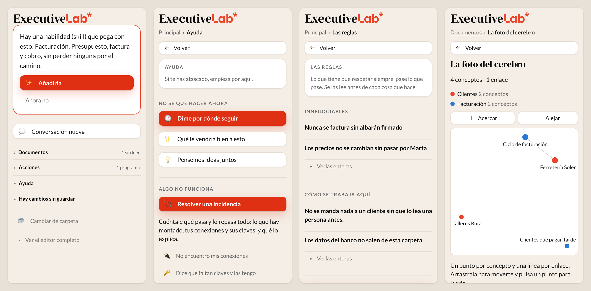

# Executive Lab

Convierte VS Code en **una sola pantalla sencilla** para trabajar con un arnés de IA: sin ficheros a
la vista, sin rutas, sin terminal y sin la palabra «commit».

Está pensada para gente de pyme que no programa —y que a veces tiene poca soltura con el ordenador—
y se apoya en [RSC](https://github.com/ericrisco/rsc-harness), que es quien monta el arnés de verdad.



## Qué hace

- **Una brújula**: dónde estás, qué acabas de hacer, qué puedes hacer ahora.
- **Tus conexiones**: las claves de cada herramienta como un formulario, con los pasos para sacarlas.
- **Lo que sabe de tu trabajo**: la wiki del arnés, leída dentro, sin markdown ni cabeceras técnicas.
- **Copias de seguridad**: git por debajo, sin que esa palabra aparezca nunca. Y una copia fuera de
  este ordenador, entrando en GitHub con la ventana del propio editor — sin claves escritas a mano.
- **Qué hay en esta carpeta**: pieza por pieza, hasta qué punto está montada. Incluidas las claves
  que ya tuvieras en un `.env` de antes, que se detectan sin tocarlas.
- **Algo va mal**: revisa, arregla y da un código de seis letras para el tutor.
- **Contárselo a Executive Lab**: un fallo, algo que no se entiende o una idea, como una incidencia en el
  GitHub de la barra. También lo puede dejar preparado el asistente, o la barra cuando falla por dentro;
  siempre se enseña entero y solo sale si la persona dice que sí.
- **Tu marca**: si dices cuál es la web de tu empresa, la barra se pinta con sus colores y su logotipo.
- **Al día**: cuando se publica una versión nueva, la barra se pone al día sola, sin bajar nada a mano, y
  lo dice arriba; quien prefiera, puede pedir que pregunte antes. Solo instala el paquete de esa release,
  entero y con su huella. Al ponerla, dice qué trae; y quien quiera puede probar las versiones nuevas antes
  que nadie.
- **Lo que contaste**: cuando lo que se contó a Executive Lab se arregla, la barra lo dice.

Nada de eso está escrito en el código: sale de leer lo que el arnés tenga montado en tu carpeta. Una
gestoría acaba con botones de facturación y una empresa de contratos con botones de contratos.

**Sobre un proyecto que ya existe**, el panel mira antes de tocar: dice qué ha encontrado, el botón
pasa a ser *Añadir el asistente a esto*, y nunca escribe nada en un historial que no sea suyo.

## Qué necesitas

- **VS Code 1.98 o más nuevo** y **Claude Code** o **Codex**, con una cuenta de pago del que uses.
- **git**. Hace falta de verdad: el arnés lo usa por su cuenta. Si no está, se pone al pulsar «Preparar
  esta carpeta», con el instalador oficial de tu sistema, y mientras tanto te hace las preguntas.

No hace falta instalar Node: la barra usa el que lleva VS Code, también para lo que el arnés hace solo, y
el arnés viaja en la propia extensión.

## Cómo se instala

La barra no está en la tienda de extensiones del editor: se instala desde su `.vsix`. Descárgalo de
[la última release](https://github.com/Executive-Lab/executive-vscode-interfaz/releases/latest) y
arrástralo a VS Code, o `Ctrl+Shift+P` → *Extensions: Install from VSIX*. Después se pone al día sola.

## 🤖 Para agentes: «instálame esto»

Si eres un agente (Claude Code, Codex, Cursor…) y te han pedido instalar Executive Lab, esto es lo
que hay que hacer. **Pregunta antes de ejecutar nada** y no des por supuesta ninguna respuesta.

```bash
# 1. La extensión, desde el .vsix de la última release
gh release download --repo Executive-Lab/executive-vscode-interfaz --pattern '*.vsix' --dir /tmp
code --install-extension /tmp/executive-lab-*.vsix --force
```

Después **no montes el arnés por tu cuenta**: dile a la persona que abra la carpeta con la que quiere
trabajar y pulse **Preparar esta carpeta** en la barra de la izquierda. (Si esa carpeta ya tiene un
proyecto suyo, el botón se llama **Añadir el asistente a esto** y el panel enseña antes lo que ha
encontrado.)

El asistente de la extensión le hará las preguntas que RSC necesita —de qué va, qué quiere resolver,
qué tal se maneja, con quién trabaja y, si va a construir algo, de qué
tamaño— en lenguaje llano, y montará el arnés con esas respuestas.

Si prefiere que lo hagas tú, las respuestas son suyas, no tuyas: pregúntaselas una a una y luego

```bash
npx @ericrisco/rsc@4.1.9 onboard \
  --technical-level <non-technical|mixed|technical> \
  --project-kind <software|operations|research|content|mixed> \
  --goal "<lo que quiera conseguir>" \
  --software-scope <small|growing|complex> --workflow main \
  --target <claude|codex>
# el tamaño y --workflow main solo cuentan con software y mixed, y con esos dos son obligatorios.
# imprime un plan y su huella; solo después de que ACEPTE ese plan exacto:
npx @ericrisco/rsc@4.1.9 onboard ...mismos flags... --accept-plan <huella>
# y como la deja la barra (decisión 145): la rama principal abierta y nada que salga sin preguntar
npx @ericrisco/rsc@4.1.9 main unlock
npx @ericrisco/rsc@4.1.9 knowledge-sync off
npx @ericrisco/rsc@4.1.9 git-permissions off
```

Y por último, los raíles de Executive Lab (idioma y vocabulario), que van dentro de la extensión:

```bash
node <carpeta-de-la-extension>/media/railes/aplicar.js "<su carpeta>"
```

Mira solo, con git, de quién es el historial de esa carpeta. Si no lo creó la barra, no apaga nada
de lo que decide su equipo (las marcas que RSC apunta en su `.rsc.json`), y si git no se puede usar la
trata como de alguien (decisión 161).

**Lo que no debes hacer:** encender la vista sencilla por tu cuenta. Es un ajuste de carpeta
(`executiveLab.vistaSencilla`) y lo decide esa persona, desde el botón de la barra o cuando el
asistente se lo pregunte al terminar. Su editor es suyo.

## Si quieres quitarlo

Desinstala la extensión y ejecuta *Executive Lab: Quitar el aspecto de todo el editor* antes, o
después borra a mano las claves que empiezan por `workbench.`, `window.` y `claudeCode.` de tus
ajustes. No toca nada más de tu configuración.
